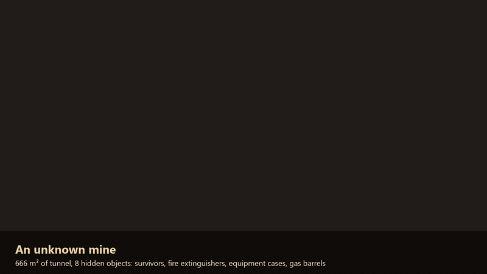
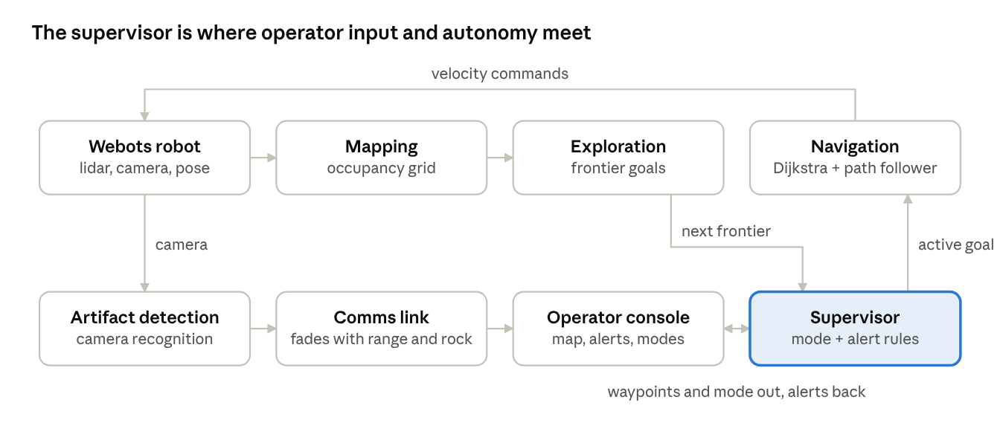
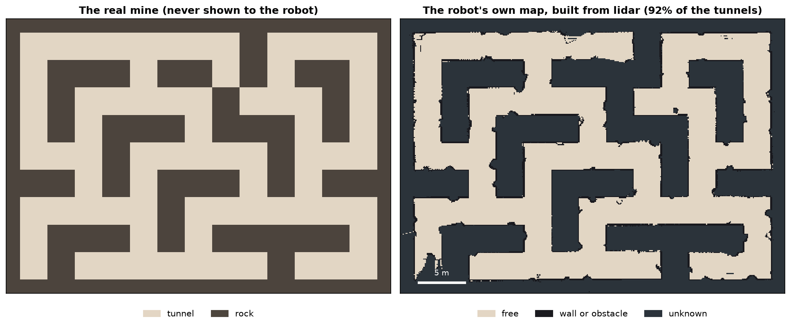
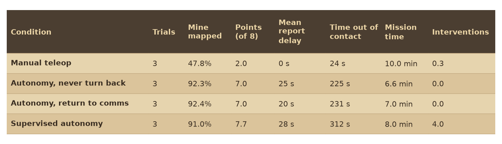

# SubT Explorer: supervised underground exploration in Webots

A one-week reproduction of the mission loop from the **DARPA Subterranean Challenge**:
a ground robot enters an unknown mine, maps it with lidar, decides where to explore next,
finds survivors and hazards, and reports them to a base station over a radio link that
drops out underground, while a human operator supervises and can step in.

Built for the Iterate phase of The Knowledge Society (TKS), as groundwork for
**HMIS (Human-Machine Intent Synchronization)**, a framework I am developing for how
machines can act on what a human intends, not just what they command.

## What it does

| Part | How |
|---|---|
| Mapping | Log-odds occupancy grid (10 cm cells) from a 5-layer lidar flattened to 2D |
| Exploration | Frontier-based: pick the edge of unexplored space with the best distance/size trade-off |
| Navigation | Dijkstra on a safety-padded map, pure-pursuit path following, collision guard |
| Object reports | Camera recognition + added sensor noise, averaged over sightings, scored with SubT's 5 m rule |
| Radio link | Signal fades with distance and rock; reports queue while the link is down |
| Supervisor | Robot-initiated alerts, return-to-comms to deliver held reports, lost-link failsafe |
| Operator console | Shows only what the base station received; click to send waypoints; commands queue with no link |

## Results (12 trials, 10-minute mission clock)

- **Manual teleop** stalled at the edge of radio coverage: about 48% of the mine, 2 of 8 objects.
- **Autonomy** mapped about 92% and scored 7 of 8, but missed the same object in every trial.
- **Supervised autonomy** found that object in two of three runs, at the cost of extra time and attention.

Full numbers: [`docs/results.md`](docs/results.md) and [`docs/results.csv`](docs/results.csv).

## Run it

Requires [Webots R2025a](https://cyberbotics.com) and Python 3 with `numpy`, `opencv-python`, `matplotlib`.

1. Open `worlds/mine.wbt` in Webots and press Play. The **Operator console** window opens.
2. Click the 3D view, then:

| Key | Action |
|---|---|
| W / A / S / D | Drive while held (needs the radio link) |
| T | Autonomy on / off |
| Click the console map | Send the robot to that point |
| H / X | Return to base / cancel waypoint |
| G | Collision guard on / off |
| V / C | Show the robot's live map / the operator console |
| M | Save a map snapshot |

Every run is logged to `logs/run_*` (map, trajectory, reports, messages).

## Project layout

| Path | What it is |
|---|---|
| `controllers/mine_explorer/` | Webots adapter: the only code that touches the simulator |
| `controllers/cinecam/` | Camera robot used only to film the demo video |
| `core/` | Simulator-independent logic: mapping, planning, exploration, artifacts, comms, supervisor, console |
| `tools/build_world.py` | Generates the mine world and its ground truth from a text grid |
| `tools/experiment.py` | Runs the experiments and builds the results table and chart |
| `tools/eval_map.py` | Scores a single run |
| `tests/` | Offline tests that run without Webots (`python tests/test_exploration.py`, etc.) |
| `docs/` | Results and article figures |

## What is simplified

This is a simulation. The robot's position comes from the simulator (no SLAM), mapping is 2D,
object recognition is the simulator's own (with noise added), the radio is a simple model with
no relay nodes, and there is one robot, one mine and one operator. See the article for details.

## Credits

- Mission design and scoring after the [DARPA Subterranean Challenge](https://www.darpa.mil/program/darpa-subterranean-challenge),
  with particular reference to CMU's Team Explorer and Team CERBERUS.
- Robot model (Robotnik Summit-XL Steel), props and the rock and concrete textures in `worlds/textures/`
  come from [Cyberbotics Webots](https://github.com/cyberbotics/webots) (Apache License 2.0).
